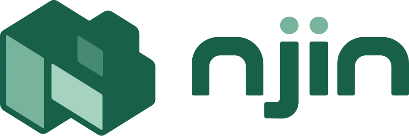

<p align="center">
  <a href="https://njin.run">
    
  </a>
</p>

<p align="center">
  <a href="https://github.com/njinlabs/njin-admin/actions/workflows/ci.yml"></a>
  <a href="https://github.com/njinlabs/njin-admin/actions/workflows/codeql.yml"></a>
  <a href="https://www.npmjs.com/package/@njinlabs/njin-admin"></a>
  <a href="LICENSE"></a>
</p>

## About njin admin

njin admin is the admin panel for [njin](https://github.com/njinlabs/njin). It gives your team a clean place to manage a site, and it lets you add your own pages, menus and dashboard widgets as plugins instead of forking the panel.

- **Content, without the setup.** Lists, forms, drafts, publishing and multiple languages follow the models you define in njin.
- **Files and users.** A file manager, and groups with permissions that decide what each person sees and can do.
- **A dashboard you build.** Every user picks the tiles they want.
- **Connected apps.** Approve AI agents and other apps that act on your behalf, and take their access back at any time.
- **Extensible.** Plugins add pages, menus, widgets and custom form inputs, and look like part of the panel.
- **Light and dark.** Follows your system.

## Getting Started

You do not need to install njin admin by hand. A new njin project already includes it:

```bash
bunx @njinlabs/njin create my-web
```

To add it to an existing project, or to update it:

```bash
bunx njin update --admin
```

Then open `/_admin` on your site.

## Documentation

The documentation, including how to write a plugin, lives at **[njin.run/docs](https://njin.run/docs)**.

## Contributing

Thank you for considering contributing to njin admin! Please read the [contribution guide](CONTRIBUTING.md) first.

## Security Vulnerabilities

If you discover a security vulnerability in njin admin, please follow the steps in our [security policy](SECURITY.md). Please do not open a public issue.

## License

njin admin is open-source software licensed under the [MIT license](LICENSE).
